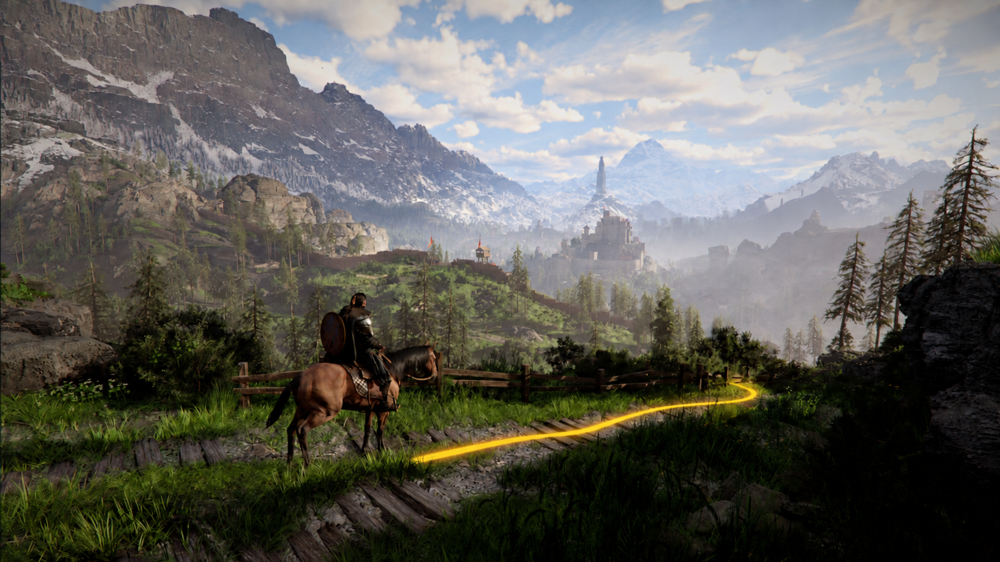
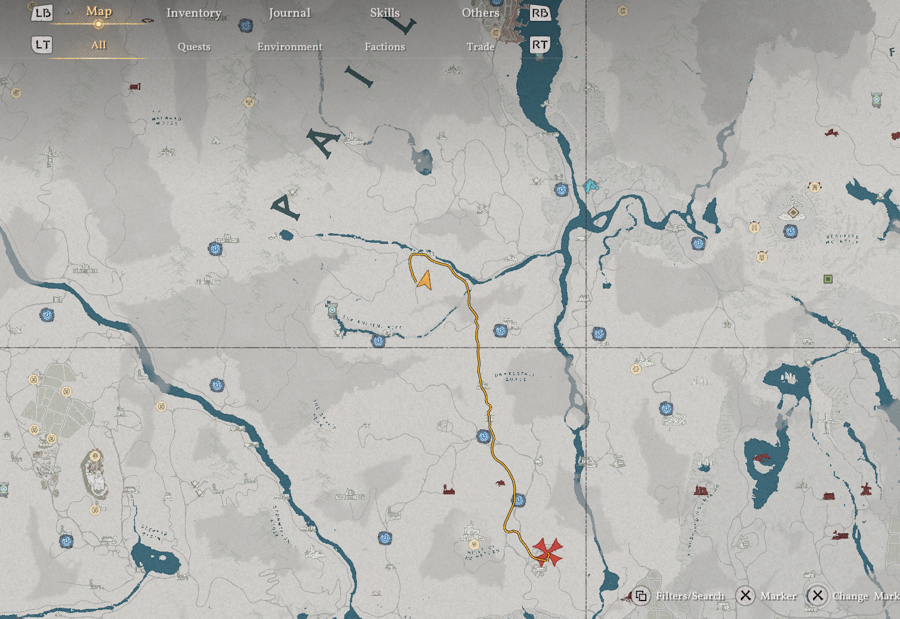
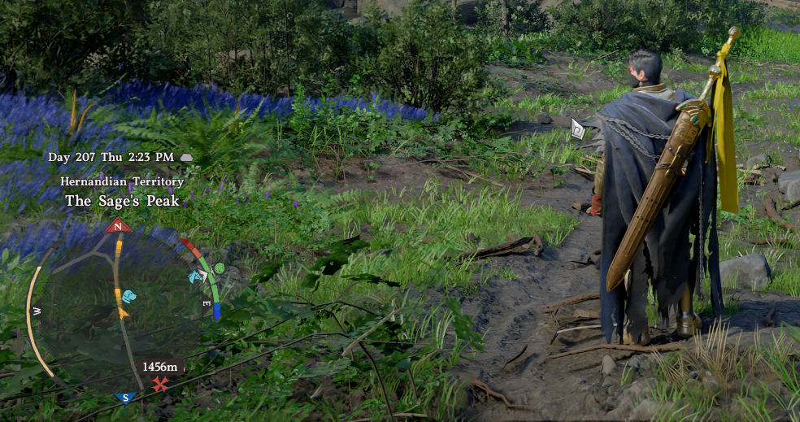
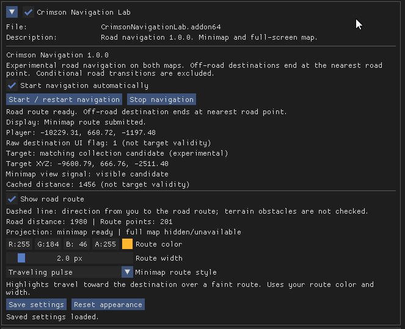

<p align="center">
  
</p>

# Crimson Navigation

Road navigation for **Crimson Desert** through a native ReShade add-on. Set an active navigation destination and the mod draws a road-following route on the minimap and full-screen map, with custom color, width, and minimap styles.

**Current version:** 1.0.8 (`1.0.8-test3` internally)<br>
**Runtime requirement:** Windows x64 and [ReShade](https://reshade.me/) with full add-on support<br>
**Download:** [Nexus Mods](https://www.nexusmods.com/crimsondesert/mods/3447)<br>
**Release record:** [1.0.8 notes and verification](outputs/release-1.0.8/RELEASE-INDEX.md)

> The header is an AI-edited promotional illustration based on an official Pearl Abyss screenshot. The highlighted world-space line illustrates the concept; the actual add-on draws routes on the game maps.

## In game

| Full-screen map route | Traveling-pulse minimap route |
|---|---|
|  |  |

<p align="center">
  
</p>

These are genuine user gameplay captures from version 1.0.0 and illustrate the route presentation. The menu image shows that older version and saved custom settings. Current 1.0.8 behavior was separately verified on patch 2.04. See [image sources and use](docs/images/README.md).

## Features

- Road routes to the active navigation destination on the minimap and full-screen map.
- Solid, traveling-pulse, dashed, and dotted minimap styles; solid full-map routes.
- Saved route color, opacity, width, and style settings.
- Route width that scales with display resolution.
- Moving route start and recalculation after sustained deviation.
- Directional player-to-road guide for off-road starts.
- Automatic executable map-class and minimap-layout detection without an exact version/hash allowlist.
- Fail-closed validation for map identity, projection data, destinations, and road records.

Routes minimize geometric road distance rather than measured travel time. Conditional road connections are excluded, and off-road destination endpoints stop at the nearest road point. The directional connector does not test terrain obstacles or move the character automatically.

## Patch 2.04 compatibility

Game patch 2.04 (Steam build 26480954 / executable 1.0.0.3576) broke version 1.0.7 in several places at once. The road archive format version went from 46 to 47. Minimap object members moved by different amounts. The destination icon kind changed. Every UI element gained an 8-byte member before its visibility flags. The full-map projection block moved outside the old search window. Version 1.0.8 handles these without pinning a game build:

- The road loader reads the file by its actual size and accepts newer format versions only while the required `worldmaproad` identity and every consumed record and boundary check remain valid. A version newer than the last measured one is reported as unverified.
- Minimap member layouts are measured profiles. A profile is used only when the minimap canvas class identity sits at exactly one profile's canvas member; no match or an ambiguous match is rejected.
- The full-map reader searches a wider bounded window for exactly one plausible canvas/transform block, then re-reads it and the object identity before drawing.
- Route width and on-screen spacing scale with display resolution, so 4K routes keep their 1080p proportions.

The complete regression suite, untouched patch 2.04 archive probe, read-only live probes, deployment checks, and installed gameplay pass. The user confirmed routes on both maps and full-map pan/zoom at 1920x1080 and approved the 3840x2160 result. Details are in the [patch 2.04 compatibility review](outputs/Update-2.04-compatibility-review.md). The earlier [patch 2.03 review](outputs/Update-2.03.00-compatibility-review.md) covers version 1.0.7.

Semantic changes to required game data can still need a mod update and are rejected rather than interpreted speculatively. A new minimap layout still needs live measurement before a profile is added.

## Install or update

1. Install ReShade with full add-on support separately.
2. Close Crimson Desert.
3. Copy **only** `CrimsonNavigationLab.addon64` into `Crimson Desert/bin64`, beside `CrimsonDesert.exe`.
4. When updating, replace only this mod's positively identified same-named add-on. Keep `CrimsonNavigationLab/settings.txt`.
5. Launch the game, load gameplay, and use the game's **Set Destination** action. User-placed map markers are distinct and do not select the active navigation destination.
6. Open **Home → Add-ons → Crimson Navigation Lab** to adjust or save appearance settings.

No installer is included. Do not replace original game files, saves, Steam configuration, ReShade files/configuration, or other mods.

## Development

Source is under [`src/`](src/) and regression tests and read-only research probes are under [`tests/`](tests/). ReShade is the only runtime dependency; local build and research tools are development-only. No game archives, extracted map data, ReShade distribution, or other authors' mod content are included.

`build.cmd` uses the Windows Visual Studio 2026 Build Tools installation and expects separately obtained ReShade SDK headers at `work/reference/reshade/include` with matching Dear ImGui headers under `work/reference/reshade/deps/imgui` (API 20 / ImGui 1.92.5).

```powershell
cmd /c build.cmd
```

The command runs the regression and native-host checks and writes the development add-on under `outputs/local-test-1.0.8/build/`. The verified 1.0.8 release archive is recorded under [`outputs/release-1.0.8/`](outputs/release-1.0.8/RELEASE-INDEX.md); generated binaries and ZIP files remain local and are excluded from source control.

## Known limitations and reports

- Minor minimap drift or turn lag can remain visible.
- Overlapping or disconnected road data can produce ambiguous or unavailable routes.
- Combat and other interactions can temporarily hide the route; it should return while the active navigation destination remains set.
- Many DLC islands have no world-map roads in the game data; routes to destinations there end at the nearest road point.
- Only 1920x1080 and 3840x2160 were checked on patch 2.04.
- Linux/Proton remains unverified.

When reporting a problem, include the mod, game, and ReShade versions; OS or Proton/Wine version; resolution and UI scale; route style; whether the issue changes during pan, zoom, movement, or destination clearing; and a screenshot or relevant sanitized log excerpt. See [known issues](docs/known-issues.md).

## Credits, images, and licensing

Developed with OpenAI Codex and Anthropic Claude Code and iterative user-directed testing. Substantial code and documentation were AI-generated. Crimson Route was research context only; none of its files are included or required.

ReShade and Dear ImGui retain their respective licenses; see [`THIRD-PARTY-NOTICES.txt`](THIRD-PARTY-NOTICES.txt). No project-wide open-source license has been selected, so public source visibility does not itself grant redistribution rights.

Header source: official Pearl Abyss promotional screenshot, modified with an AI-edited gold route highlight and used under the recorded fan-content policy review. Gameplay images were supplied by the user. This is unofficial content which contains copyrighted materials and IP from Pearl Abyss, and is not official/endorsed content.
